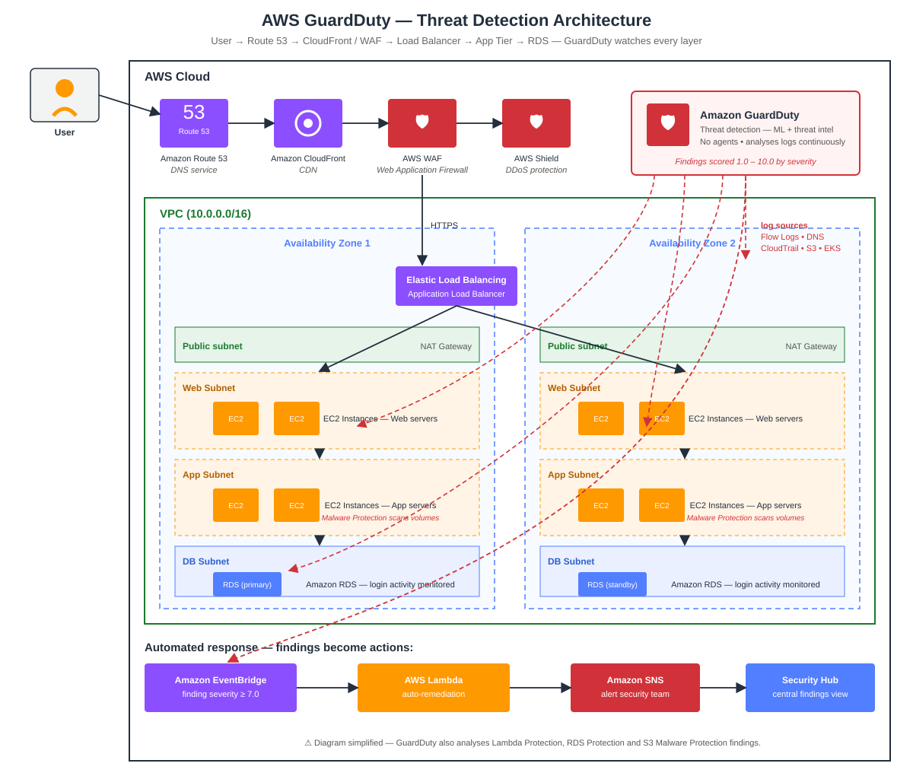

# AWS GuardDuty Threat Detection Guide 🛡️


> **TL;DR:** GuardDuty is AWS's managed threat-detection service. You turn it on with one click — no agents, no sensors — and it continuously analyses VPC Flow Logs, CloudTrail events, DNS logs, S3, EKS audit logs and more, flagging compromised instances, stolen credentials, crypto-mining and data exfiltration with a severity score. Wire its findings to EventBridge and you get **automatic incident response** in seconds, not hours.

---

## Why GuardDuty Matters

| Problem | Without GuardDuty | With GuardDuty |
|---|---|---|
| Compromised EC2 mining crypto | Found weeks later via the bill 😱 | Flagged in minutes (`CryptoCurrency:EC2/BitcoinTool.B`) |
| Stolen IAM keys used from abroad | Invisible until damage is done | `UnauthorizedAccess:IAMUser/InstanceCredentialExfiltration` |
| Log analysis | Build your own SIEM, hire analysts | Managed ML + threat intel, on by default |
| DNS data exfiltration | Almost impossible to spot manually | DNS log analysis flags anomalous lookups |
| Incident response | Manual, slow, 3 a.m. pager duty | EventBridge → Lambda auto-isolates the host |

## How GuardDuty Works

```
┌──────────────────────────────────────────────────────────────────┐
│ DATA SOURCES (no agents — GuardDuty reads AWS-native logs)        │
│  • VPC Flow Logs        • CloudTrail management events           │
│  • DNS logs             • S3 data events & S3 Protection         │
│  • EKS audit logs       • RDS Protection (login activity)        │
│  • Lambda Protection    • Malware Protection (EC2 & S3)          │
└──────────────────────────────┬───────────────────────────────────┘
                               ▼
┌──────────────────────────────────────────────────────────────────┐
│ THREAT INTEL + MACHINE LEARNING                                   │
│  • AWS threat-intel feeds (known bad IPs, domains, Tor nodes)     │
│  • ML baselines per account — flags behaviour that deviates       │
│  • Suppression rules — silence known-good findings                │
└──────────────────────────────┬───────────────────────────────────┘
                               ▼
                    FINDING (severity 1.0 – 10.0)
              Low 1.0–3.9  │  Medium 4.0–6.9  │  High 7.0–8.9  │  Critical 9.0+
                               ▼
         EventBridge → Lambda (isolate) → SNS (alert) → Security Hub
```

GuardDuty never sees your traffic payloads — it analyses **metadata** (who talked to whom, when, how much), so there is nothing to install and nothing to slow your workloads down.

## Architecture



**Traffic / detection flow:** User → Route 53 → CloudFront / WAF → Application Load Balancer → EC2 app tier (private subnets across 2 AZs) → RDS. In parallel, GuardDuty continuously analyses the logs of every layer — VPC Flow Logs, DNS, CloudTrail, S3 and EKS — and streams findings to EventBridge, which triggers a Lambda auto-remediation function (quarantine the instance, disable the leaked key) and an SNS alert to the security team, with everything centralised in Security Hub.

## Finding Types You Will Actually See

| Finding (example) | What it means | Severity |
|---|---|---|
| `CryptoCurrency:EC2/BitcoinTool.B` | EC2 talking to a known mining pool | High |
| `UnauthorizedAccess:IAMUser/InstanceCredentialExfiltration` | EC2 role credentials used from an external IP | Critical |
| `Trojan:EC2/BlackholeTraffic` | EC2 connecting to a known C2 / blackhole IP | High |
| `Recon:EC2/Portscan` | Something is port-scanning your instance | Medium |
| `Exfiltration:S3/ObjectRead.Unusual` | S3 objects read from an unusual location/principal | Medium |
| `Persistence:IAMUser/AnomalousBehavior` | IAM user behaving unlike its baseline | Medium |
| `Malware:EC2/*` | Malware Protection found a malicious file on EC2 | High |
| `Impact:EC2/AbusedDomainRequest.Reputation` | EC2 querying a domain with a bad reputation | Medium |

## Severity — What to Do With Each Level

| Severity | Score | Response |
|---|---|---|
| **Critical** | 9.0–10.0 | Page the on-call now; auto-isolate the resource |
| **High** | 7.0–8.9 | Investigate within the hour; auto-remediate if the pattern is known |
| **Medium** | 4.0–6.9 | Triage same day; check whether it matches a suppression rule |
| **Low** | 1.0–3.9 | Review weekly; usually reconnaissance noise or misconfiguration |

**Golden rule:** never suppress a finding without writing down *why* — a suppression rule that hides a real attack is worse than the alert noise it removes.

## Automating Response with EventBridge

GuardDuty findings are events. Route them and let code do the boring first response:

```
GuardDuty finding (severity ≥ 7)
        │  EventBridge rule: source = aws.guardduty
        ▼
Lambda auto-remediation
        ├─ EC2 finding  → attach quarantine security group (no egress),
        │                 snapshot the volume for forensics, tag "quarantined"
        ├─ IAM finding  → disable the compromised access key, force re-auth
        └─ S3 finding   → enable S3 Block Public Access, notify the owner
        ▼
SNS → security team        Security Hub → central findings dashboard
```

The demo in [`guardduty_automation.py`](guardduty_automation.py) implements exactly this pipeline — enable GuardDuty, list findings, and simulate the remediation for a crypto-mining finding.

## GuardDuty vs Security Hub vs Inspector — Don't Mix Them Up

| Service | Job |
|---|---|
| **GuardDuty** | *Detects* threats in progress — "something bad is happening right now" |
| **Security Hub** | *Centralises* findings from GuardDuty, Inspector, Config, Macie — one dashboard |
| **Inspector** | *Scans* for vulnerabilities before they are exploited (EC2, ECR, Lambda) |
| **Config** | *Checks* whether resources comply with your rules over time |
| **Macie** | *Finds* sensitive data (PII) in S3 |

Think of it as: **Inspector** finds the unlocked door, **GuardDuty** catches the burglar walking through it, **Security Hub** is the alarm panel on the wall.

## Cost Cheat Sheet (us-east-1, 30-day free trial on first enable)

| Data source | Price (approx.) |
|---|---|
| VPC Flow Logs analysis | $1.00 / GB analysed |
| CloudTrail management events | $0.50 / 1M events |
| DNS logs | $0.40 / 1M events |
| S3 Protection | $0.50 / 1M events |
| EKS Protection | $0.20 / vCPU / month |
| Malware Protection for EC2 | $0.03 / GB scanned |
| Malware Protection for S3 | $0.03 / GB scanned |

> 💡 **Cost trap:** VPC Flow Logs is usually the biggest line — enable GuardDuty in a sandbox first, watch the first week's bill, then roll out account-wide. The 30-day free trial covers every protection plan, so use it to measure before you commit.

## Code

[`guardduty_automation.py`](guardduty_automation.py) — a complete, runnable demo:

- `enable_guardduty()` — enable the detector + all protection plans in one call
- `list_high_findings()` — pull findings with severity ≥ 7 and print them readably
- `remediate_crypto_mining()` — quarantine an EC2 instance (isolating security group + snapshot + tag)
- `disable_compromised_key()` — revoke a leaked IAM access key
- `create_eventbridge_rule()` — wire findings to Lambda + SNS automatically

```bash
pip install boto3
python guardduty_automation.py --demo
```

## Quiz

Think you got it? [Take the 5-question quiz →](quiz.md)

---

## Checklist

- [ ] Enable GuardDuty in every Region you use (threats don't respect Region boundaries)
- [ ] Turn on all protection plans — S3, EKS, Lambda, RDS, Malware Protection
- [ ] EventBridge rule: severity ≥ 7 findings → Lambda + SNS, not just email
- [ ] Auto-remediation tested in a sandbox before it touches production
- [ ] Suppression rules documented with a reason and an expiry date
- [ ] Findings forwarded to Security Hub for one central view
- [ ] Weekly review of Medium/Low findings — baselines drift as workloads change
